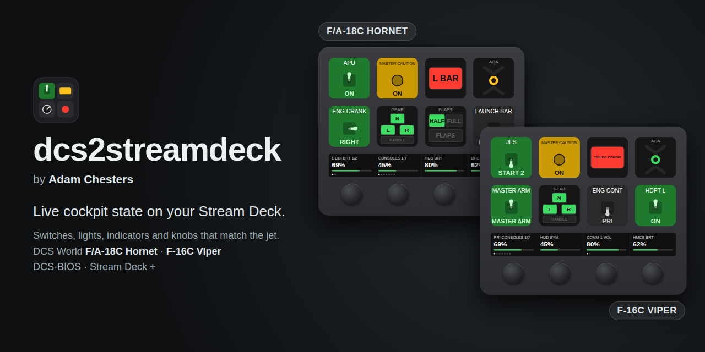
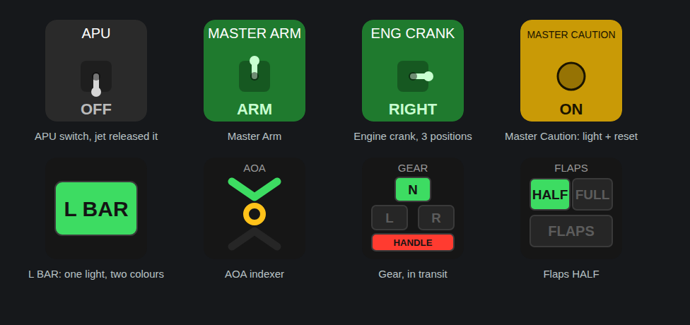

  

# dcs2streamdeck

Stream Deck keys, lights and dials that show what your jet is actually doing in DCS World.

**For the DCS F/A-18C Hornet only.** One plugin per aircraft keeps the control lists short; the F-16C has its own: [dcs2streamdeck-f16c](https://github.com/AdamChesters/dcs2streamdeck-f16c).

## Why

The DCS Stream Deck projects I tried had gone quiet. Some no longer worked with current DCS, and none kept the deck in step with the cockpit: when the jet moved a switch by itself, like the magnetically held APU or launch bar switch, the key kept showing the wrong thing. dcs2streamdeck reads the live cockpit through DCS-BIOS, so the deck always matches the jet.

## Examples

  

- **DCS Switch**: any switch, button or lever. Shows its real position (ARM/SAFE, EXTEND/RETRACT) and can light up from its own cockpit light.
- **DCS Light**: caution and warning lights in their cockpit colours, plus combined indicators: AOA indexer, flaps, landing gear and L BAR.
- **DCS Dial** (Stream Deck +): turn to set brightness and volume knobs; press to step through a list. Presets for the DDIs, cockpit lighting and displays.
- **VR**: a live copy of the deck at `http://127.0.0.1:31730/` for an OpenKneeboard Web Dashboard tab.

## Install

1. Install [DCS-BIOS](https://github.com/DCS-Skunkworks/dcs-bios/releases) v0.11 or later.
2. Use the Stream Deck app 7.1 or later.
3. Download the latest `.streamDeckPlugin` from [Releases](https://github.com/AdamChesters/dcs2streamdeck/releases) and double-click it.

Building from source: [docs/DEVELOPMENT.md](docs/DEVELOPMENT.md).

## Credits

- [DCS-BIOS](https://github.com/DCS-Skunkworks/dcs-bios) by DCS-Skunkworks: the cockpit data and controls everything runs on.
- [Stream Deck SDK](https://github.com/elgatosf/streamdeck) by Elgato.
- [OpenKneeboard](https://openkneeboard.com) by Fred Emmott, for putting the deck in your headset.
- [node-elgato-stream-deck](https://github.com/julusian/node-elgato-stream-deck) by Julian Waller, [Electron](https://www.electronjs.org), [React](https://react.dev), [Lucide](https://lucide.dev), [ws](https://github.com/websockets/ws) and [Zod](https://zod.dev).

Licence notices: [LICENSES.md](LICENSES.md). dcs2streamdeck is licensed under the [GPL-3.0](LICENSE).

## Feedback and donations

I love making things. Anything I've ever built has been to have fun, share fun, and make life a bit easier. If you got value from one of these things, and you'd like to chuck us a coffee, a bottle, or a god damned Ferrari, go your hardest. Then hustle over to discord to claim your supporter role!

[GitHub Sponsors](https://github.com/sponsors/AdamChesters) | [Buy Me a Coffee](https://buymeacoffee.com/adamch) | [Donate with PayPal](https://www.paypal.com/donate/?business=KLHSZPXTSVSAU&no_recurring=0&item_name=I%27ve+donated+to+lots+of+small+creators+for+their+useful+little+tools%2C+now+I+create+them.+Dig+one?+I%27d+love+your+support.&currency_code=AUD)

[Join the Discord](https://discord.gg/fs4WyaQPA)
